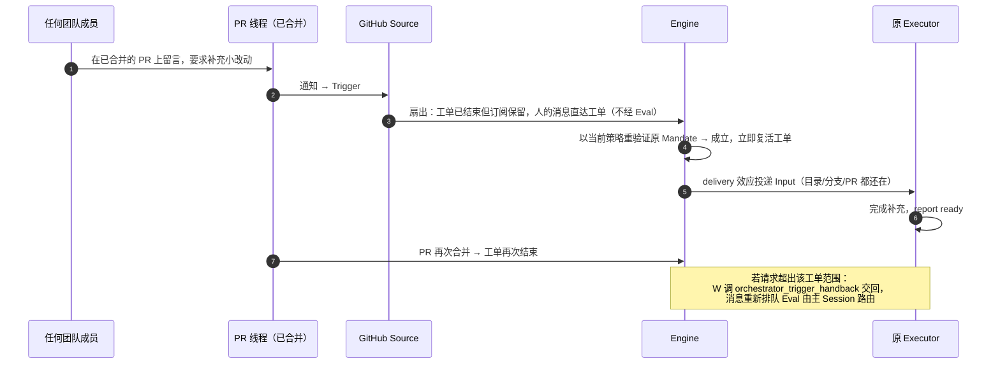
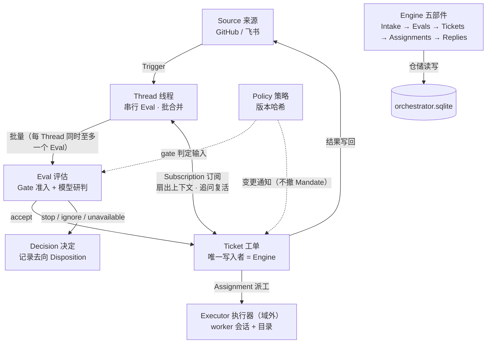
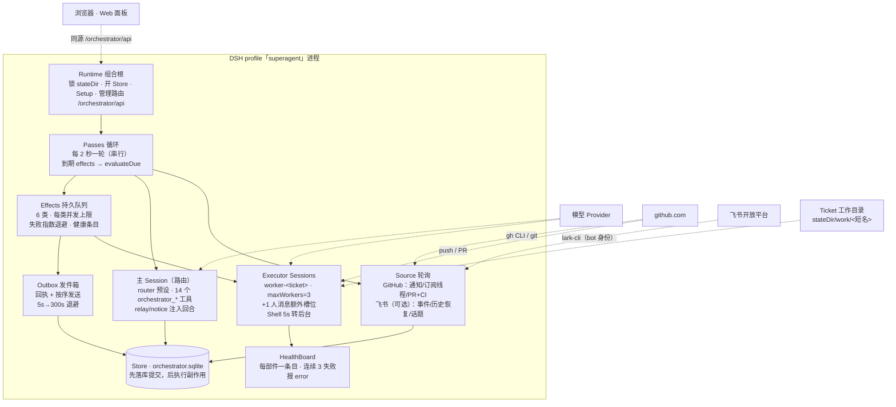
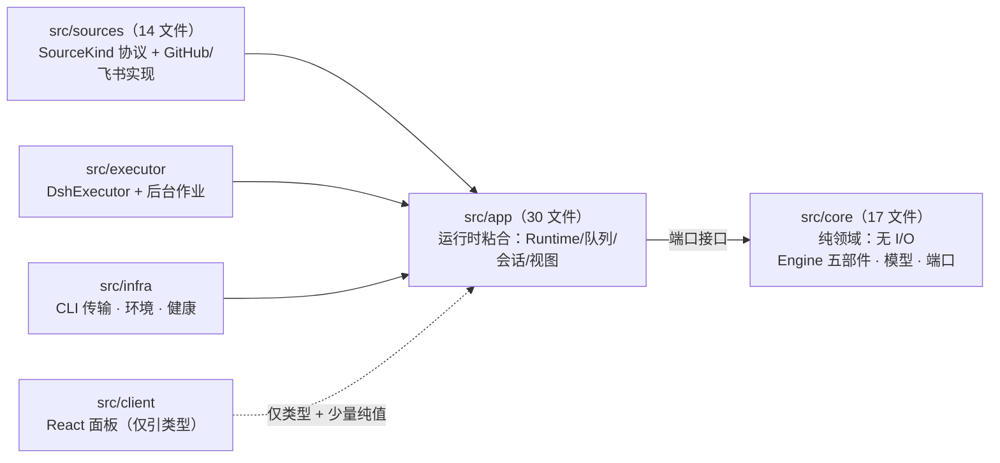
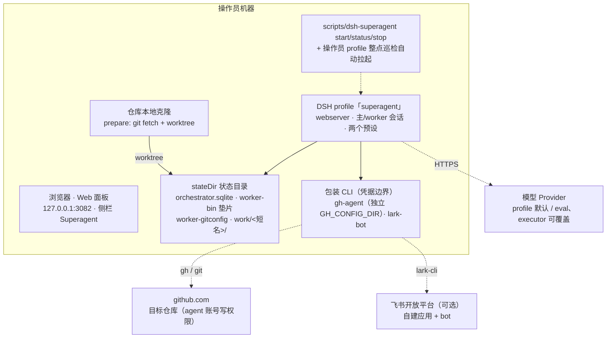

# dsh-superagent · 4+1 架构视图

> 依据 `docs/000-000` 至 `docs/008` 与 `src/` 源码（100 个源文件）梳理。配套交互版：[4plus1-views.html](4plus1-views.html)；设计深化见 [design-deep-dive.md](design-deep-dive.md)，提示词梳理见 [prompts-map.md](prompts-map.md)。

dsh-superagent 是一个面向单个 GitHub 仓库的主动编码智能体服务（DeepSeek Harness bundle）：监听 GitHub（可选飞书），在策略授权下把请求变成工单，在自己的会话与目录里执行，并在原对话交付结果。

本文按 Kruchten 4+1 模型组织：**场景视图（+1）**、**逻辑视图**、**进程视图**、**开发视图**、**物理视图**。

---

## 场景视图（+1）

### 场景 1 · 主场景：@提及 → 接单 → 交付 PR

```mermaid
sequenceDiagram
    autonumber
    participant U as 允许名单成员
    participant GH as GitHub
    participant S as GitHub Source
    participant E as Engine
    participant M as 主 Session
    participant W as Executor
    participant O as Outbox
    U->>GH: 评论 @agent，要求修复拼写（匹配 copy 规则）
    GH->>S: 通知（轮询周期约 1 分钟）
    S->>E: Trigger 幂等入库，归入 Issue 对应 Thread
    E->>E: Gate：名单内 + 点名 → explicit（明确请求）
    E->>M: 候选卡（assessment 效应送入回合）
    M->>E: orchestrator_route · accept
    E->>O: 单事务建 Ticket+Mandate+Assignment+Subscription
    O->>GH: 原对话发出确认评论（≤100 词）
    E->>W: launch：prepare（git worktree）→ worker-&lt;ticket&gt; 会话
    W->>GH: 编码、自审、开 PR，report progress 绑定 pr_number
    W->>E: report ready（自审 + 检查通过）
    E->>O: 交付：原对话发结果 + PR 链接
    U->>GH: 审阅并合并
    GH->>E: threadClosed → followsDone，工单以 merged 结束
    O-->>U: IM 渠道收到一条合并结果通知
```

要点：

- **明确请求任意接受模式都放行**（off/observe/auto），Gate 只看名单与是否点名，不读内容。
- 建单是**单事务原子操作**；确认消息经 Outbox 回执、按工单×会话保序发送。
- 执行器默认不启用 auto-merge（GitHub 把合并归到启用者名下），由人合并。

### 场景 2 · 订阅线程上的追问（复活工单）



要点：

- 追问**不需要再次 @agent**；订阅（Subscription）就是继续工作的授权通道，但不授予新授权（Mandate 不变）。
- bot 与 CI 消息不会唤醒已结束的工单；只有人的消息能复活，且被人 stop 过的工单不再接收任何消息。

### 场景 3 · 主动观察模式（observe）

```text
打开 observeIssues / observePulls / observeComments / observeCi 开关
  → 仓库里每个新 Issue / PR / 评论 / 默认分支 CI 都进入系统
  → 非点名、发送者不在名单的消息按准入表形成「推断候选」（inferred）
  → 主 Session 完整评估后只记录「would accept」（Decision 记 ignore + would-accept 标记）
  → 团队回看记录，判断评估质量
  → 切到 auto 模式：同样的评估通过后真正建单，
     Mandate 记录 observation 依据与匹配规则，授权范围收窄
```

要点：哲学是「从小开始」——先观察再放权；所有去向（filtered / ignored / would-accept / accepted）留痕，可随时 `reevaluate` 重评。

---

## 逻辑视图

领域概念与主流程（唯一能建工单的路径是 Eval）：



### 核心概念

| 概念 | 一句话定义 | 关键规则 |
| --- | --- | --- |
| Source 来源 | 事件流：一个可复用的 kind + 一个实例配置 | 持有读位置，重启不重放；进域前过滤自己的消息与未监听事件 |
| Trigger 触发 | 不可变事件，审计与幂等单元 | 重复接受只建一个工单；去向记录在 Disposition |
| Thread 线程 | 时间序的 Trigger 集合 | 同一时刻至多一个 Eval，期间到达的合并进下一批 |
| Channel 渠道 | Thread 的写侧（评论/回复/PR） | 同工单同会话严格按序；渠道永久消失则丢弃留痕 |
| Policy 策略 | 版本化评估规则 + 各 Source 名单/准入表/bot 表 | 版本覆盖规则、接受模式与 Source 部分；变更不撤销在途 Mandate |
| Eval 评估 | 一批 Trigger 到一个 Decision 的判定 | 两层：确定性 Gate + 主 Session 研判；无自身状态 |
| Mandate 授权 | accept 授予什么：策略版本/范围/强度/匹配规则/发送者身份 | 不可变；只有人的 stop 或复活重验证失败能撤回 |
| Ticket 工单 | 已授权的工作单元 | 只有 Eval 能创建；阶段自持，不跟随执行器状态 |
| Assignment 派工 | 工单与一个执行器实例的绑定 | pending→running→ended，独立于工单生命周期 |
| Subscription 订阅 | 工单×线程多对多关系（由 Thread 持有） | 匹配消息无差别扇出；人的消息可复活已结束工单 |

### 关键不变量

1. **Mandate 不可变**：工单结束不撤回授权；只有人的 stop 直接撤回，或复活时重验证失败才撤销。
2. **单一写入者**：Trigger/Thread/Decision/Ticket/Assignment 只由 Engine 写；Source 只能经 `bindThread` / `threadClosed` 影响工单；回执只由 Outbox 写；健康条目由认领的部件写。
3. **幂等与审计**：Trigger 一次存储多处引用；一个候选至多一个工单；每个决定记录原因码与证据。
4. **域外执行**：Executor（会话+目录）在领域之外，经 Assignment 端口接入；其报告（progress/waiting/ready/blocked/failed/dropped）是结构化事实，不是自由文本。
5. **强度三档**：explicit（名单内点名 / 有工单线程上的追问 / 准入表 explicit 格）· inferred（准入表 inferred 格 / 名单内 bot）· 不准入（其他 bot、被忽略格、off 模式下一切推断）。

---

## 进程视图

单个 DSH profile 进程（本机 `127.0.0.1:3082`）内的组件：



### Effects：六类持久副作用（命令先落库、提交后才执行）

| 类别 | 做什么 | 并发 | 重试/退避 |
| --- | --- | --- | --- |
| `assessment` | 把评估候选卡送入主 Session 回合（送达即启动截止计时） | 4 | 2s 起倍增至 60s |
| `launch` | 启动派工：prepare 命令 → worker 会话 → 派工消息 | 空闲槽位数 | 瞬时故障 5s→300s ×3；prepare 失败即工单失败 |
| `delivery` | 把等待中的 Input 按序投给运行中的派工 | 4 | 2s 起倍增至 60s（失败显示在工单上） |
| `relay` | worker 报告/提问、人的追问 → 主 Session 回合（保序） | 1 | 2s 起倍增至 60s |
| `notice` | 不打扰式通知注入主 Session（保序） | 1 | 2s 起倍增至 60s |
| `reply` | 经 Source 渠道发出 Outbox 消息（同工单同会话保序） | 1 | 5s→300s；渠道消失则丢弃留痕 |

### 并发与恢复语义

- **worker 槽位**：工单从 launch（含 prepare）或唤醒投递起持有槽位；人的消息/状态请求可用第 +1 个槽且优先于新启动——新工作永远挤不掉人。
- **后台作业**：每回合结束后台作业至多 30 分钟；移交人后子代理停止、给人试的 Shell 作业（如预览服务）继续跑且不占槽。
- **重启恢复**：中断的派工带恢复备注续跑（先查目录/git/GitHub 再重复外部动作），最老工单优先；未取进会话历史的消息保留；Input「已读」按步记录。
- **暂停**：停止派工/新评估/超时/投递，但 Source 继续记录；暂停期间 Eval 不超时，恢复后截止时间顺延暂停时长。
- **优雅停机**：等执行器至多 5 分钟、作业至多 10 秒；绝不强杀。

---

## 开发视图

TypeScript + ESM，tsdown 构建，vitest 测试（60 个测试文件）。分层与依赖方向：



### 模块速览

| 层 | 关键模块 | 职责 |
| --- | --- | --- |
| `src/core` | `engine.ts`（唯一入口 + 五个角色化 Pick 接口）、`intake/evals/tickets/assignments/replies`（五个 EnginePart）、`model.ts`、`ports.ts`、`memory.ts`（内存仓储） | 领域规则；除 node 哈希外零依赖、零 I/O，可在内存上全量测试 |
| `src/app` | `runtime.ts`（组合根）、`passes/effects/outbox`、`sessions.ts`、`assessment.ts`、`store.ts`（SQLite）、`views/`、`tools/`、`prompts.ts`、`settings.ts`、`setup.ts` | 进程编排、持久化、面板视图、会话与工具注册 |
| `src/sources` | `kind.ts`（SourceKind 协议）、`registry.ts`、`github*.ts` ×5、`feishu*.ts` ×6、`poll.ts` | 外部事件 → Trigger 的翻译层；`github-watch`/`feishu-watch` 为独立插件入口 |
| `src/executor` | `dsh.ts`（WorkerSlots、prepare）、`background.ts`（Shell 作业/子代理） | 派工执行、并发槽位、后台作业治理 |
| `src/infra` | `commands.ts`（CLI 传输）、`environment.ts`（垫片+隔离 gitconfig）、`health.ts`（HealthBoard） | 进程边界与基础设施 |
| `src/client` | `app.tsx`、各页面 tsx、`locales.ts`（双语文案） | Web 面板；只允许 import 宿主侧类型 |

### 依赖规则（代码有测试守护）

- `src/core` 不 import 自身之外的任何东西（除 node 哈希）；`src/sources` 不 import `src/app`；面板无循环依赖。
- 每个类收到**显式窄接口**（多为其他类的 `Pick` 类型）：`EngineForSources/MainSession/People/Settings/Executor` 五个角色视图。
- 每类状态一个写入者（见逻辑视图不变量 2）。
- 命名约定：请求用祈使句（`stopTicket`），适配器上报的事实用过去式（`assignmentStarted`）。
- 构建产物 `lib/`：`index.js`（主插件）、`client.js`（面板）、`github-watch.js`、`feishu-watch.js`；`pnpm check = typecheck + test + build`。

---

## 物理视图

常规部署是**一台操作员机器**（Linux + tmux 会话）加三个外部系统；本机实例为 Windows 后台进程：



### stateDir 布局

| 路径 | 内容 |
| --- | --- |
| `orchestrator.sqlite` | 全部状态（trigger/thread/ticket/decision/effect/outbox/kv）；唯一写入者 Store；升级前备份是回滚唯一途径 |
| `worker-bin/` | 命令垫片（`gh`→agent CLI、`lark-cli`→bot CLI、被封命令失败），置于 worker PATH 首位 |
| `worker-gitconfig` | 替代全局/系统 gitconfig：agent CLI 作为 github.com 凭据助手、SSH 改写 HTTPS、LFS 过滤器；移除 `GH_TOKEN`/`GITHUB_TOKEN` |
| `work/<短名>/` | 每工单独立目录（默认 prepare 用 `git worktree` 创建） |

### 本机（Windows）运行实录

服务已于 2026-11-01 在本机启动并运行，过程中排掉三个 Windows 环境差异，供复现参考：

1. **dsh 版本**：本机原为 0.1.2-rc.1，不满足 `engines.dsh: ^0.2.1-alpha.2`，升级到 `@deepseek-ai/dsh@0.2.1-rc.3`。
2. **插件链接路径**：Git Bash 会把 `link:$PWD` 转成无效的 `/e/...` 路径；改用原生盘符路径 `link:E:/coding/...` 安装（`dsh plugin --profile superagent add`）。
3. **stateDir 校验**：`src/deployment.ts:13` 的 schema 要求以 `/` 开头（`pattern(/^\//)`）。不改源码的办法：写成 POSIX 形式 `/Users/13423/.dsh/state/superagent`，并让进程从 C: 盘启动（`cd ~ && dsh --profile superagent`），Windows 的 fs 层把它解析为 `C:\Users\13423\.dsh\state\superagent`。
4. **启动方式**：官方脚本 `scripts/dsh-superagent` 依赖 `fcntl`/`tmux`（仅 Unix）；Windows 直接后台运行 `dsh --profile superagent --no-open`。
5. **当前状态**：runtime 正常、`paused`（等待配置，等同 `status` 退出码 3）——未配置 GitHub 仓库与 agent 账号属预期；`GET /orchestrator/api/state` 可查健康。

要让它真正接活，还差操作员步骤：创建 agent 专用 GitHub 账号并授予仓库写权限、`gh-agent` 包装 CLI 登录、按 SETUP.md 逐项配置 Source / Policy / Execution。
