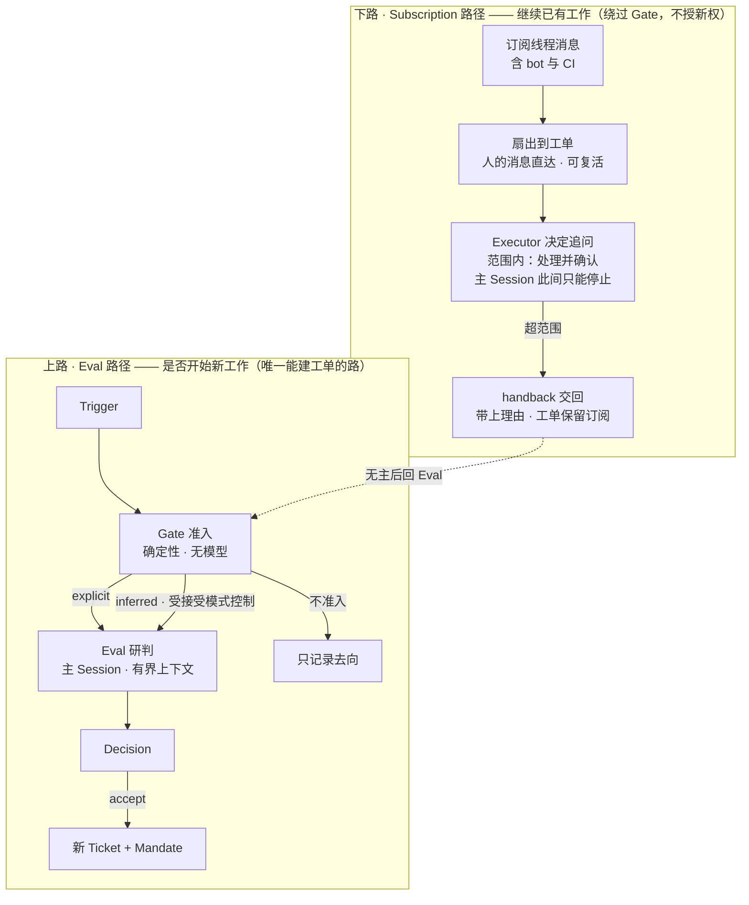
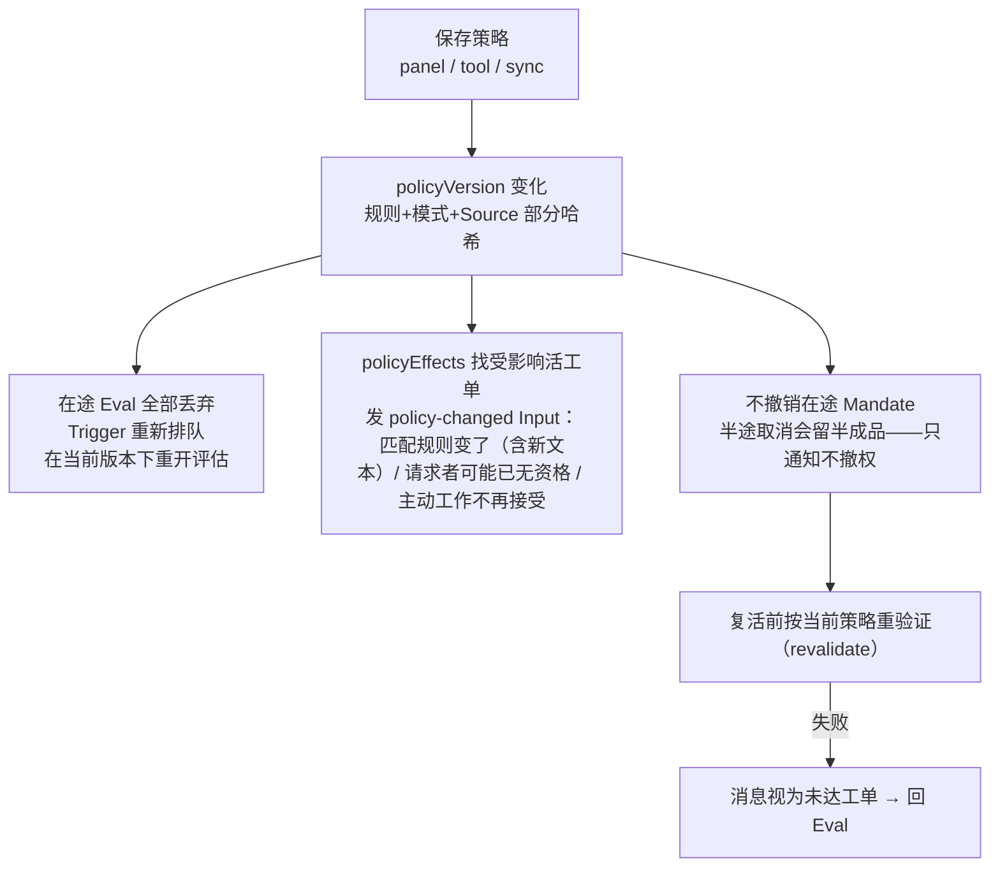

# dsh-superagent · 设计思路与处理流程深化

> 承接 [4plus1-views.md](4plus1-views.md)：为什么这样设计 · 每个阶段怎么处理 · 五类知识如何更新生效。依据 `docs/000-philosophy`、`002-authorization`、`003-execution`、`004-prompts`。配套交互版：[design-deep-dive.html](design-deep-dive.html)。

---

## 一、设计思路

### 核心原则

> **占用尽可能少的人类注意力，交付尽可能多的价值。**

每条消息、每个通知、每个问题、每个设置、面板上的每个元素、每段文档都要消耗某个人的注意力——产出的价值必须大于这个成本，否则就被删掉。整个系统按这个标准做减法。

### 五条设计支柱

| 支柱 | 内容 |
| --- | --- |
| 概念最少 | 领域只有九个核心概念（Source/Trigger/Thread/Channel/Policy/Eval/Mandate/Ticket/Assignment/Subscription）。业务需求变成其中一个概念的属性，或一段提示词——不为它新增概念 |
| 设置最少 | 当一个默认值适合几乎所有团队，这个设置就消失。能用语言描述的行为（何时合并、如何措辞）是提示词，不是开关 |
| 面板只显示需要人的 | 总览第一屏永远是「等一个人处理什么」；健康状态不占版面。评估超时未解决才找人，且 24 小时后不再打扰 |
| 单一写入者 | 每类状态只有一个写者，其余角色只读或请求写者——写冲突在结构上不可能 |
| 显式窄依赖 | 每个类拿到的接口只命名它用到的部分（TypeScript Pick）；Engine 按角色暴露五个视图，Source 只见 SourceContext。核心 `src/core` 零 I/O，60 个测试文件可在内存仓储上全量验证 |

### 决策权分离：谁决定什么

| 角色 | 决定 | 不做 |
| --- | --- | --- |
| **Gate 准入**（确定性代码） | 谁能发起工作；强度是 explicit 还是 inferred。依据：允许名单、是否点名、准入表、bot 列表、接受模式 | 不读内容、不调用模型——规则相同则结果必同，这是授权可审计的原因 |
| **主 Session**（模型研判） | accept / attach / stop / ignore，一次路由多个候选 | 不做技术决策；不改写请求（不加实现计划/验收标准）；不等待（禁止 sleep/轮询） |
| **Executor**（技术执行） | 技术方案；范围内追问是否接；何时 ready | 不能自我授权（Mandate 限定）；不能宣布「人要我停」；超范围消息 handback 交回 |
| **人**（最高决定权） | stop 直接撤回 Mandate；暂停只有人能解除；审阅与合并 | ——对话里说「停」也只是普通 Trigger，仍走评估 |

### 提示词强度阶梯（从强到弱）

1. **工具与宿主强制的事实**——身份、权限、工具参数校验、回复用途与长度上限。提示词改不动它们。
2. **内置段落**（可被团队覆盖）——角色职责、订阅与回复、派发与工作、准入研判、环境与策略模板。
3. **匹配规则的要求**——仅对该推断工单的 Executor 生效；可覆盖默认（如静默规则抑制确认消息）。
4. **团队段落与团队技能**——沟通/工单范围/交付要求三段 + 按需加载的技能。
5. **外部文本**——消息、评论、引用的文档：只是评估输入，**永不改变规则与授权**。

### 运营责任（写进 philosophy 的四条军规）

- **从小开始**：先短允许名单 + 主动工作只记录（observe），看准了再放宽。
- **为更少噪音调优**：吵了就改短改严提示词或暂停，不要加更多解释消息。
- **不用它刷量**：批量 PR、广播消息、假忙的代价大于收益。
- **对它说的话负责**：以团队名义发出的每句话都要能被人在提示词里纠正。

---

## 二、处理流程

### 十个阶段

每阶段给出参与者、关键规则与失败/恢复语义。暂停（pause）时：Source 继续记录 Trigger，派工/新评估/超时/投递全部停住，恢复后各截止时间顺延暂停时长。

**1 · 采集**（GitHub/飞书 Source · 轮询循环）
- 规则：通知轮询约每分钟；订阅线程在工单存活期间轮询、结束后再追两周；Source 持有读位置（kv 游标），重启从断点继续。
- 失败：读失败记在自己的 Thread 上，下一轮重试；连续 3 轮失败才升级为 Source 错误；GitHub 404 也重试（私库失去权限同样返回 404）；持续失败一天后放弃该条目，读位置不动。

**2 · 过滤**（Source）
- 规则：丢弃 agent 自己发出的消息（防自激励）；mentions-only 模式丢弃未 @机器人 的消息；每个被过滤的 Trigger 记录原因码。
- 失败：过滤只丢事件不删记录——审计上始终可回答「为什么没反应」。

**3 · 入域**（Intake / Engine）
- 规则：`Engine.receive` 幂等接收：一次落库 + Disposition 去向记录；按 Source 映射归入 Thread；扇出到订阅工单作上下文；人的消息直达工单不再评估；其余在主 Thread 排队等 Eval（串行、批合并）。
- 失败：全部在一个事务里，落库成功才可能有后续副作用。

**4 · 准入**（Gate，确定性代码）
- 规则：名单内点名 → explicit（任何模式放行）；名单外在有工单线程追问 → inferred；bot 列表内 bot 只能产生推断候选；模式 off 一切推断不入、observe 只记录「would accept」。
- 失败：准入表弱化不立即叫停在途工单——复活重验证时才可能撤 Mandate。

**5 · 研判**（主 Session · MasterAssessor）
- 规则：候选卡经 assessment 效应送入当前回合（并发 4）；上下文由代码装配（Thread 前 5 条 + Trigger 左右各 5 条、≤8 个相关工单、候选 4000 字）；每条启用规则逐一判定；推断候选必须完整评估；explicit 候选一次 `orchestrator_route` 可批量决定、各项独立。
- 失败：截止时间从候选**送达**起算，未送达永不超时；超时重排两次、第三次记 `unavailable`；暂停期间不超时。

**6 · 建单**（Engine · Tickets/Replies）
- 规则：单事务原子创建 Ticket + Mandate + 首个 Assignment + Subscriptions，同时队列确认消息（≤100 词，原对话发出）。
- 失败：渠道消息按工单×会话保序；渠道永久消失（Issue 删除/会话锁定/消息撤回）丢弃留痕。

**7 · 派工**（Effects(launch) · DshExecutor）
- 规则：prepare 命令在执行根目录跑一次（默认 10 分钟上限，典型 `git fetch` + `worktree`）；worker 会话命名 `worker-<ticket>`；槽位 = maxWorkers，人的消息可用 +1 槽且优先。
- 失败：瞬时故障（408/429/5xx/断连）按 5s→300s 重试 3 次；prepare 失败或非瞬时失败 → 工单记失败，等人的消息或手动重试，不自动重跑。

**8 · 执行**（Executor Session）
- 规则：6 个 `orchestrator_*` 工具；报告六态（progress/waiting/ready/blocked/failed/dropped）；要人回答走结构化 `human_action` 字段、一次一个具体问题；追问由 Executor 决定归属；后台作业每回合 30 分钟上限。
- 失败：blocked/failed 后不再自动投递输入（CI/bot 消息只记录不投递）；人的消息、非失败报告或重试解除；会话错误记 failed；模型瞬时故障续跑 15/30/60 秒三次；工单结束后工具整体拒绝。

**9 · 交付**（Executor · Outbox · Channel）
- 规则：PR 认领规则（分支最后一段 = 工单短名）；回复四用途（确认/回答/结果/待人工决定）；同工单同会话严格按序；auto-merge 由交付要求段治理，默认不用 agent 账号启用。
- 失败：渠道永久消失丢弃留痕不重试；回复的评论不存在时改发 PR 主会话。

**10 · 收尾与恢复**（Engine · Effects · 面板）
- 规则：`threadClosed → followsDone`——它开的 PR 都关了（或没开 PR 而 ready）即结束，结局取最后一次关闭；结束时未读且未被认领/回答/交回的追问释放回 Eval；重启时中断派工带恢复备注续跑、最老工单优先。
- 失败：优雅停机等执行器至多 5 分钟；`person/delivery|blocked|failed` 状态可手动 retry（同会话/目录/分支/PR 换新派工）。

### 授权双路径：整个模型的关键分岔

- 明确请求在**任何接受模式**下都走通；推断候选受 `off / observe / auto` 三档模式控制。
- 追问所有权在工单活着时持续，甚至覆盖「已结束但非被人 stop、有消息在等复活」的工单。
- 上下文型订阅（`followForContext`）送达消息但不授予权力、不复活工单。
- 交回的消息带上各执行器的理由成为新候选；门按普通线程消息重新判定它。

---

## 三、知识更新处理

系统里五类知识，各有版本化与生效路径：

| 知识类型 | 写入者 | 存放 | 更新触发 | 生效方式 | 审计 |
| --- | --- | --- | --- | --- | --- |
| 策略 Policy | Settings（panel / tool / sync 三种 origin） | 设置块 + `policyVersion` 哈希 | 规则/接受模式/名单/准入表/bot 表任一变化 | 变更即生效：丢弃在途 Eval 重排；通知受影响活工单；复活前重验证 | 每个 Mandate 记录所依据的版本 |
| 提示词 Prompts | panel 或主 Session 工具 | 不可变编号快照（Versions） | 团队保存 / 升级带来新默认 | 每次模型请求都读最新版（同回合后续步骤亦然）；不重启会话 | 版本含前身/时间/来源；覆盖记录默认基线 |
| 设置 Settings | Settings（origin 决定权限，只有 panel 能改执行环境与账号字段） | 分块 revision + 历史快照 | 面板/工具/名单同步保存 | 保存即生效；改账号类字段触发重启再跑 Setup | 乐观并发：过期 revision 返回 409 拒绝 |
| 外部世界状态 | 各 Source | kv：读游标/CI 指纹/话题消息 | 每轮轮询增量推进 | 重启不重放；缺口走历史恢复；订阅线程轮询至结束后两周 | 丢失的回复留 dropped 记录（何时/为何） |
| 会话与执行知识 | Sessions / Executor | 会话历史 + Input 已读记录 + 恢复备注 | 通知/报告/追问/停机 | 通知不打扰注入；转发保序；重启后中断派工带恢复备注续跑 | Executor 只能读它工作过的提示词版本（mayRead） |

### 策略变更的传播流程

**设计取舍**：弱化准入格（或把人移出名单）不会立刻叫停已接的工单——取消会留下半成品；只在工单复活重验证时，才按今天的表与名单可能撤销其 Mandate。各依据的重验证条件不同：explicit 追问 Mandate 直接通过；inferred 需要 auto 模式且匹配规则仍启用；准入表 Mandate 需按今天的表仍能获得原强度；bot Mandate 要求 bot 仍在列表。

### 提示词版本：改动如何到达正在工作的会话

- 每次保存生成**不可变快照**：完整配置 + 编号 + 前身 + 时间 + 来源；恢复旧版也是新版本；过期基准保存被 409 拒绝、草稿不丢。
- 会话**每次模型请求**都读最新版本——同一回合的后续步骤也用新文案；保存不重启、不打断、不唤醒会话。
- 宿主记录每个会话用过的版本；Executor 只能读它**工作过**的版本（mayRead 限定）。
- 策略段（`runtime/policy`）放提示词最后、由设置实时生成——策略变化不动前面的文本。
- 升级后：未覆盖的段自动跟新默认；覆盖过的标记「默认已更新」并排差异，团队保留/换新/再改三选一。
- 校验防漂移：未知键、缺失模板占位符、保留技能名一律拒绝，从不静默截断；与默认相同的覆盖自动清除。

### 世界与会话状态：增量、恢复、不重放

- Source 把读位置存 kv：重启从位置继续，不重放事件；飞书另有历史恢复补缺口。
- **先落库后执行**（stored work）：转发、派工、投递都先写进 effect/outbox 队列再做事——进程死在半路，重启后队列还在。
- 停机保留未取进会话历史的消息；重启时中断的 Assignment 附恢复备注（先查目录/git/GitHub 再重复外部动作）。
- Input 的「已读」按步记录：被取消的步骤不算读过；工单结束时未读且未被认领/回答/交回的追问释放回 Eval。
- Schema 迁移单向：`SCHEMA_VERSION` 只升不降，新库拒绝旧版启动；升级前备份 `orchestrator.sqlite` 是回滚唯一途径。
